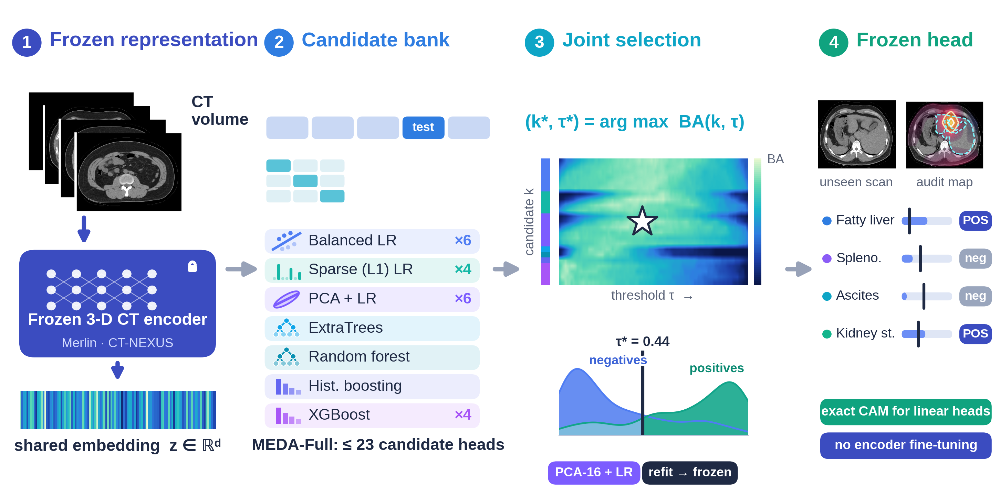
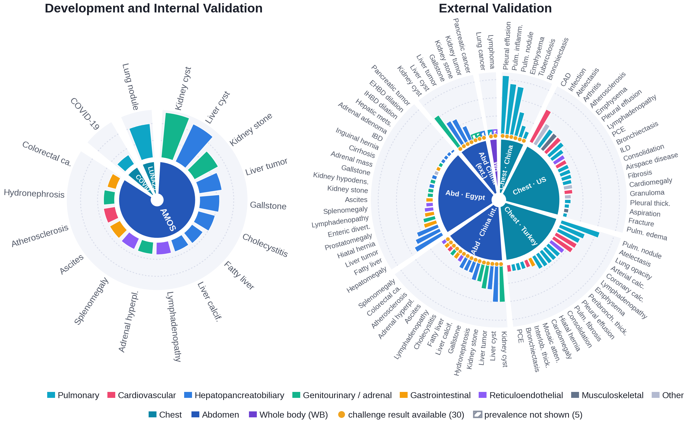
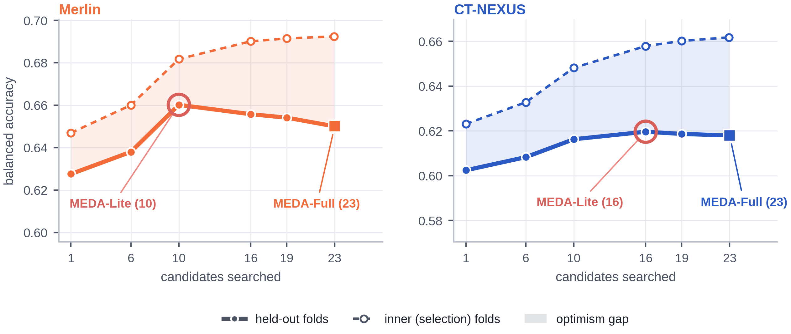
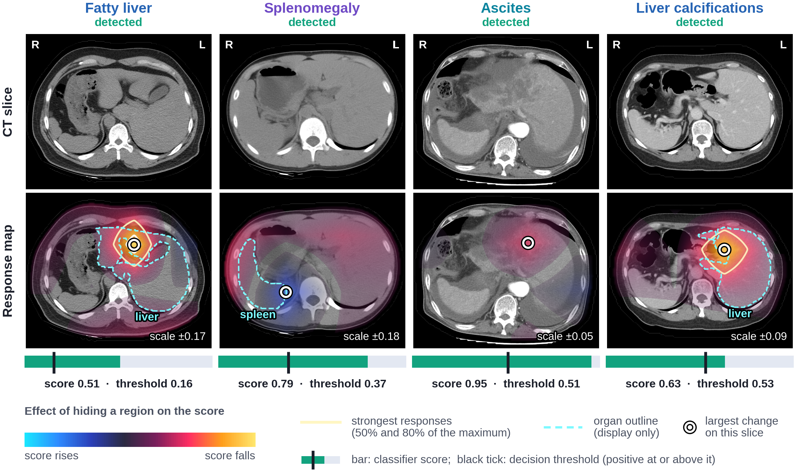

<h1 align="center">MEDA</h1>
<h3 align="center">Metric-Conditioned Decision Adaptation for Multi-Target CT Recognition</h3>

<p align="center">
  <a href="https://www.codabench.org/competitions/12650/"></a>
  <a href="https://fmv-cvpr26workshop.github.io/"></a>
  <a href="https://github.com/kmin940/CVPR26-3DCTFMCompetition/tree/main/Certificates_by_model_team"></a>
  <a href="assets/certificate.png"></a>
</p>

<p align="center">
  
  
  
  
  
</p>

<p align="center">
  
</p>

MEDA picks a classifier and an operating threshold for every clinical finding while the pretrained CT encoder stays frozen. Each finding gets its own head, chosen from labeled training cases only, so a new finding can be added without touching the encoder.

This repository is the code and results behind the paper by Dharini Raghavan, Amritpal Singh and Anant Madabhushi. MEDA received the **Meritorious Winner Award** in the Embedding Aggregation Optimization (Task 2 EAO), Vision-Language track of the [CVPR 2026 Foundation Models for General CT Image Diagnosis challenge](https://www.codabench.org/competitions/12650/) (team `dharini24`).

## How it works

1. A frozen encoder (Merlin, 2,048-d, or CT-NEXUS, 1,120-d) turns each CT study into one embedding.
2. A bank of 23 classifier settings is fitted on three inner folds of the training cases: balanced logistic regression, sparse logistic regression, PCA followed by logistic regression, ExtraTrees, random forest, histogram boosting and XGBoost.
3. For every candidate, the threshold that maximizes balanced accuracy on its out-of-fold scores is found. The candidate and threshold pair with the highest balanced accuracy is kept.
4. The chosen classifier is refitted on all training cases. At inference, a study is positive when its score reaches the stored threshold.

**MEDA-Lite** uses the same rule over the first 10 (Merlin) or 16 (CT-NEXUS) candidates. It was defined after looking at held-out folds, so its numbers are exploratory, and it was not part of the challenge submission.

## Results

All numbers are means over 17 findings and five outer folds. Every method uses the same features, patients and folds.

| Encoder | Decision rule | Balanced acc. | AUROC | AUPRC | Sensitivity | F2 | G-mean |
|---|---|---:|---:|---:|---:|---:|---:|
| Merlin | Linear probe, 0.5 cutoff | 0.611 | 0.680 | 0.410 | 0.360 | 0.366 | 0.514 |
| Merlin | Balanced probe + cutoff | 0.628 | 0.679 | 0.409 | 0.580 | 0.463 | 0.608 |
| Merlin | **MEDA** | **0.650** | **0.701** | **0.422** | **0.631** | **0.490** | **0.635** |
| CT-NEXUS | Linear probe, 0.5 cutoff | 0.583 | 0.642 | 0.348 | 0.318 | 0.323 | 0.474 |
| CT-NEXUS | Balanced probe + cutoff | 0.602 | 0.642 | 0.347 | 0.558 | 0.439 | 0.574 |
| CT-NEXUS | **MEDA** | **0.618** | **0.665** | **0.373** | **0.614** | **0.464** | **0.602** |

The paired balanced-accuracy gain over the cutoff-tuned balanced probe is 0.023 with Merlin (95% interval 0.012 to 0.033).

MEDA-Lite reaches 0.660 (Merlin, 10 candidates) and 0.620 (CT-NEXUS, 16 candidates). Its selected heads need about 0.18 ms and 0.56 ms per embedding after feature extraction.

### Independent challenge cohorts

Mean balanced accuracy of the seven challenge systems on 30 finding and cohort evaluations. MEDA here is the original challenge submission.

| System | China abd. internal (15) | China abd. external (7) | China chest external (6) | Germany WB external (2) | All (30) |
|---|---:|---:|---:|---:|---:|
| **MEDA (Merlin)** | 0.6712 | **0.6673** | **0.5466** | 0.7097 | 0.6479 |
| Merlin + LP | 0.6820 | 0.6592 | 0.5411 | 0.7594 | 0.6537 |
| Merlin + EAO | 0.6463 | 0.6600 | 0.5406 | 0.7417 | 0.6347 |
| CT-NEXUS + LP | 0.5667 | 0.5782 | 0.5213 | 0.5288 | 0.5578 |
| CT-NEXUS + EAO | 0.6378 | 0.6424 | 0.5358 | 0.6382 | 0.6185 |
| VoCo-L + LP | 0.6474 | 0.6501 | 0.5121 | 0.6223 | 0.6193 |
| VoCo-L + EAO | 0.6516 | 0.6650 | 0.5075 | 0.6089 | 0.6230 |

MEDA has the highest balanced accuracy on both external Chinese cohorts. The Merlin linear probe is slightly ahead on German whole-body CT and over all 30 evaluations. Rebuild this table with `python scripts/external_table.py`.

### Figures

<p align="center">
  
</p>
<p align="center">
  
</p>
<p align="center">
  
</p>

The `figures/` folder holds every paper figure as PNG and vector PDF.

## Quick start

```bash
git clone https://github.com/rdharini2001/MEDA.git
cd MEDA
pip install -r requirements.txt
pip install -e .
```

Fit MEDA on one finding and score the held-out validation split:

```bash
python scripts/train.py --backbone merlin --target fatty_liver --out models/fatty_liver.joblib
```

Or use the estimator directly:

```python
from meda import MEDA
from meda.data import load_features

X, y, case_id, split = load_features("data/features", "merlin", "ascites")
train, val = split == "train", split == "val"

model = MEDA().fit(X[train], y[train])          # MEDA-Full, 23 candidates
print(model.name_, model.threshold_)
calls = model.predict(X[val])

lite = MEDA.lite("merlin").fit(X[train], y[train])  # MEDA-Lite, 10 candidates
```

## Reproducing the paper

```bash
python scripts/run_nested.py --backbone all --target all --jobs 8   # nested evaluation, all decision rules
python scripts/run_search_budget.py                                  # held-out accuracy versus search size
python scripts/summarize.py                                          # macro metrics, intervals, paired tests
python scripts/external_table.py                                     # independent-cohort table
pytest                                                               # unit tests
pytest -m slow                                                       # re-run one stored fold and compare
```

Each finding and encoder takes minutes on one core, and contexts run in parallel with `--jobs`. A fold re-run reproduces the stored predictions, thresholds and metrics to floating-point precision.

## Repository layout

```
meda/                 package: candidate bank, threshold search, selection, nested evaluation, statistics
scripts/              command-line entry points
tests/                unit tests and a stored-fold regression test
data/features/        frozen embeddings per encoder and finding (X, y, case_id, split)
data/                 cohort sizes and audit tables
results/nested/       per-fold candidate tables, metrics and predictions
results/summary/      macro metrics, intervals, paired tests, threshold stability
results/search_budget/ held-out accuracy by number of candidates, learning curves
results/efficiency/   training time, inference latency, model size
results/metrics/      all metrics for all rules, rank and win/loss tables
results/external_test/ per-finding challenge results and cohort means
figures/              paper figures (PNG and PDF)
docs/                 method details, data notes, reproduction notes
```

## Data

`data/features` contains the embeddings used in the paper for the 17 findings from AMOS (15 abdominal findings), COVID-19 CT and LUNA25 lung-nodule malignancy. The CT volumes themselves are not included. See [docs/data.md](docs/data.md) for the cohorts, label sources and how the embeddings were extracted.

## Documentation

- [docs/method.md](docs/method.md): selection rule, threshold search, evaluation protocol
- [docs/candidate_bank.md](docs/candidate_bank.md): all 23 candidate settings and their order
- [docs/data.md](docs/data.md): cohorts, features and extraction details
- [docs/results.md](docs/results.md): guide to every file under `results/`

## Citation

```bibtex
@misc{raghavan2026meda,
  title        = {MEDA: Metric-Conditioned Decision Adaptation for Multi-Target CT Recognition},
  author       = {Raghavan, Dharini and Singh, Amritpal and Madabhushi, Anant},
  year         = {2026},
  howpublished = {CVPR 2026 Challenge on Foundation Models for General CT Image Diagnosis},
  url          = {https://github.com/rdharini2001/MEDA}
}
```
